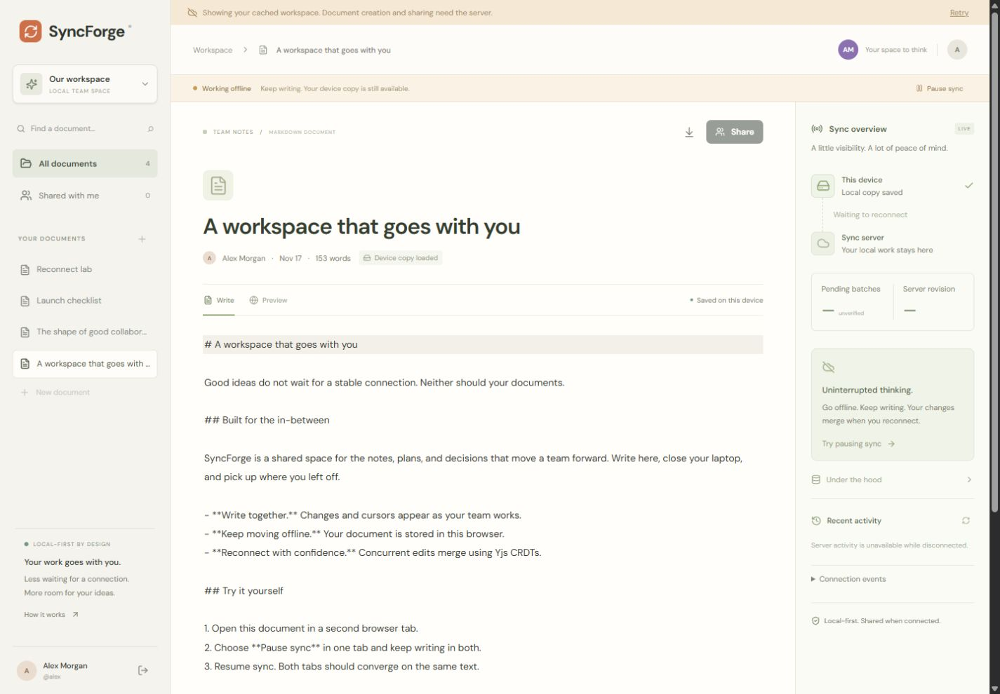

# SyncForge

**A collaborative workspace that keeps going offline.** Write Markdown together, see live cursors, pause the connection, and merge concurrent edits when you reconnect.

SyncForge is a working local collaboration system with a React/CodeMirror editor, Yjs CRDT synchronization, browser persistence, a versioned offline app shell, and an authenticated WebSocket server backed by SQLite. No paid API or external account is required.



_Actual built app during the offline reload check: the backend was stopped and the cached document remained editable._

## Get started

Requirements: **Node.js 24+** and npm. Node's built-in SQLite API is used; there is no database server to install.

```sh
git clone https://github.com/LuciferAksh/syncforge.git
cd syncforge
npm ci
npm run dev
```

Open **http://127.0.0.1:4400** and select **Try the seeded local demo**.

| Demo account | Password              |
| ------------ | --------------------- |
| `alex`       | `syncforge-demo-2026` |
| `sam`        | `syncforge-demo-2026` |

These are intentionally public **local demo credentials**. The seed creates them only when the workspace is new and preserves existing data on subsequent runs. Use **Create an account** for your own workspace. Do not expose this seeded server publicly.

## Try the important flow

1. Open a document in two browser tabs.
2. Select **Pause sync** in one tab. Edit the document in both tabs.
3. Select **Resume sync**. Both replicas should contain the merged edits.
4. Open **Under the hood** to inspect byte counters and storage details.
5. Use **Share** to give another registered account editor or viewer access. Use separate browser profiles for different signed-in accounts; tabs in one profile share a session cookie.

Pausing sync deliberately disconnects **that document's WebSocket**. It is a transport-partition demonstration, not browser airplane mode. To test actual server unavailability: visit the app and document online first, wait for **Saved on this device**, stop the server, and reload the page. The cached app shell and document remain available. Restart the server to reconnect. The cached document list can be refreshed with **Retry** after recovery.

Only previously cached documents can be edited offline. First sign-in, account creation, new documents, title changes, and sharing require the server. Unsaved browser storage failures are shown in the document warning area; export your work before closing a tab if storage fails.

## What is implemented

- **Concurrent editing:** Yjs shared text, CodeMirror bindings, per-user undo, live cursors, and ephemeral awareness.
- **Device persistence:** IndexedDB transactions merge document state across tabs, avoiding last-writer overwrite of disconnected drafts.
- **Offline app shell:** a versioned service worker precaches built assets; API responses and sessions are never put in its response cache.
- **Reconnect recovery:** state vectors exchange missing updates with exponential retry. Server acknowledgements track committed update batches.
- **Durable persistence:** SQLite WAL with synchronous FULL; updates are committed before they reach other replicas or receive acknowledgements. Transactional log compaction occurs every 20 accepted updates.
- **Access control:** scrypt password hashing, opaque HttpOnly session cookies, document ownership, editor/viewer roles, and authorization on every update. Revocation closes active collaborator connections.
- **Workspace tools:** document creation, title editing by the owner, search, Markdown preview/export, sharing management, persisted activity, and a live sync inspector.

## Run and develop

```sh
npm run build
npm start
```

Choose a separate database or port:

```sh
npm start -- --port 4401 --db data/another-workspace.db
```

`npm run seed` populates `data/syncforge.db` after a build. `npm run dev` builds, seeds if needed, and starts the server. For frontend hot reload, keep the backend on port 4400 and run `npm run dev:web` in another terminal; Vite uses port 5175 and proxies HTTP/WebSocket requests. The offline app-shell worker is generated for production builds, not Vite development.

## Verification

```sh
npm run build
npm test
npm run verify
npm run format:check
```

The automated suite covers **64 deterministic CRDT partition scenarios**, device-cache merging, actual authenticated HTTP/WebSocket flows, persistence failure, duplicate delivery, ID collisions, compaction/restart recovery, read-only enforcement, revocation, malformed updates, and input/origin guards. `verify` generates a controlled recovery report at `data/verification.json` using a fresh temporary SQLite database.

Browser verification also checks two-tab convergence, sharing, Markdown rendering/export, narrow-screen layout, and **reload/edit/reconnect with the server stopped**. These are correctness demonstrations at local scale, not a claim of production scale or zero data-loss under all failures.

## Boundaries

This release runs on a **single loopback server**. It is not a horizontally scaled or end-to-end encrypted cloud service. The CRDT engine is Yjs; SyncForge implements the application, transport, persistence, permissions, and recovery around it.

Browser data is subject to quota, eviction, private-mode behavior, profile deletion, and device failure. Device copies survive sign-out; anyone with this browser profile can inspect cached content. Permission revocation prevents later server access but **cannot erase data already downloaded**. Export important documents and protect your browser profile. The activity log describes accepted updates and sharing actions; it is not revision browsing or a restorable version-history interface.

See [architecture](docs/architecture.md), [verification](docs/verification.md), and [limitations](docs/limitations.md). MIT licensed.
