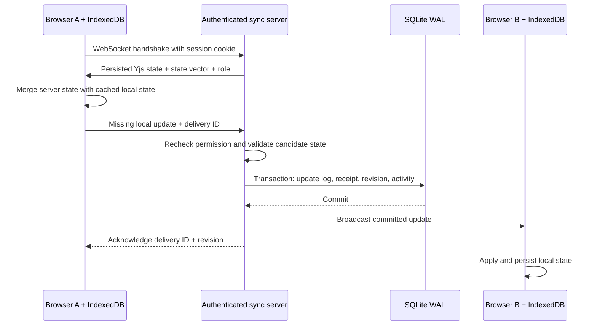

# Architecture

## Document flow

## CRDT and transport

Yjs supplies conflict resolution, shared text, binary updates, state vectors, and idempotent update application. CodeMirror uses `y-codemirror.next` for editor bindings, collaborative cursor positions, and a local undo manager. The application has one Y.Text named `content` per document; title and sharing metadata are online server operations rather than offline CRDT fields.

SyncForge uses a small JSON WebSocket protocol carrying base64-encoded Yjs updates. On connect, the server sends its canonical state and state vector. The browser applies server state to its cached replica, computes the update missing from the server, and sends it with a fresh delivery ID. Live edits send incremental updates. The browser retries interrupted connections with bounded exponential backoff and jitter. Reconnect recomputes missing state rather than trusting an in-memory queue to survive reloads.

Pending counts describe transport batches, not semantic user edits. Server revisions count accepted updates, so typing a sentence may create many revisions. Acknowledgements confirm a SQLite commit, not delivery to every peer, human review, remote backup, or an immutable historical snapshot. Unknown revision state is shown as a dash before the first handshake.

## Browser persistence and offline shell

IndexedDB stores account-keyed document metadata and binary document state. A read/write transaction merges new CRDT state with the existing stored update using `Y.mergeUpdates`. Concurrent tabs therefore preserve both disconnected drafts instead of overwriting one another's snapshots. The editor marks a local save complete only after the transaction commits. Storage errors remain visible. The provider prevents editing an uncached document until its first successful server load.

The build generates a versioned service worker containing the exact emitted asset list. Installation precaches the app shell and all chunks. Navigation is network-first with an offline index fallback; asset requests are cache-first. API and WebSocket routes are excluded. Production builds are required for this offline reload behavior. Metadata, credentials, and server authorization responses are not treated as cacheable HTTP responses.

Cached display identity permits a local offline workspace to open after a network failure. It grants no server authority: the server still requires a valid session and current membership before syncing. Different accounts have different document-cache keys, but the browser profile itself remains the local trust boundary.

## Commit and recovery

`rooms.ts` loads a room from the stored snapshot plus remaining updates. For each update, it constructs a candidate Y.Doc, checks the root shape and resource bounds, and only then calls persistence. `store.ts` wraps delivery receipt, update log, revision, activity, and optional compaction in one SQLite transaction. A failed transaction does not mutate the room or broadcast an update. After commit, the room applies the already-validated update and broadcasts it, then acknowledges the sender. A crash after commit but before acknowledgement is recovered through state reconciliation and idempotent delivery.

Each receipt binds its delivery ID to a SHA-256 digest. Reusing an ID with different bytes is rejected. No-op updates are acknowledged without increasing the revision. Every 20 accepted updates, the current Yjs state replaces the snapshot and covered log entries are deleted inside the same transaction. Receipt and activity metadata are retained. When the last connection leaves, the in-memory room is destroyed; later connections reconstruct it from SQLite. There is no cross-process room ownership or replication layer.

## Identity and permissions

Passwords use random salts and scrypt. Sessions are random opaque tokens; only token hashes are stored server-side. Cookies are HttpOnly, SameSite=Strict, scoped to `/`, and expire after seven days. The server binds to 127.0.0.1 and checks Host/Origin for both HTTP and WebSocket entry points. Mutating HTTP endpoints require JSON.

A document owner can rename it and grant editor/viewer membership to existing registered accounts. Viewers can receive updates and send bounded presence information but cannot submit document updates. Every incoming frame rechecks session validity and current role; a periodic check also expires idle connections. Sharing changes close affected sockets. Reopening an inaccessible document yields an explicit authorization close code. Revoked or downgraded offline drafts remain local and can be exported from the open document; the server does not silently accept them.

The local demo accounts are created by the seed command, not an authentication bypass endpoint. Presence validates the signed-in display name and color; it is ephemeral, with no database persistence or proof that someone read a document.
